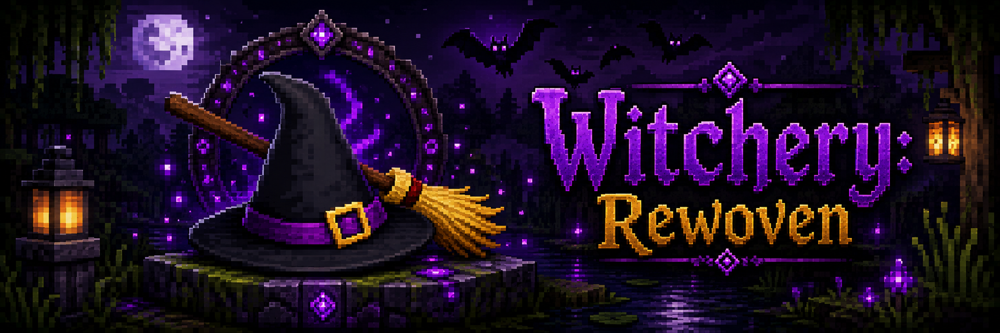

<p align="center">
  
</p>

# Witchery NeoForge Port

> *The old craft, transcribed for a new age of Minecraft.*


An unofficial modern NeoForge port and continuation of the classic **Witchery** mod for Minecraft `1.21.11`.

The aim is to restore the *feel* and mechanics of original Witchery first — the altar's hum, the cauldron's patience, the weight of a rite — then lean on community fan-mod inspiration and other references where they help close visual, item, or registry parity gaps.

## Contents

- [Current State](#current-state)
- [Feature Highlights](#feature-highlights)
- [Not Done Yet](#not-done-yet)
- [Status Docs](#status-docs)
- [Build](#build)
- [Debug / QA Helpers](#debug--qa-helpers)
- [Mirror / Torment QA Notes](#mirror--torment-qa-notes)
- [Contributing Workflow](#contributing-workflow)
- [Credits](#credits)
- [Project Notes & Legal](#project-notes--legal)

## Current State

The port is playable and well beyond prototype stage, but it remains an active parity port rather than a polished release. Many systems are implemented, and many more are in the "works, needs in-game verification and edge-case parity" phase. Recent work has focused on maturing the native Modonomicon guidebook and placed Primer block, source-style Crystal Ball and Waystone scrying, dropped Waystone transposition parity, Player Compass needle parity, vanilla-shaped custom brew liquids, source-shaped thrown brew transport, gas-brew protection/lifetime parity, Disease brew and disease-block spread parity, Purified Milk disease cleanup, Dog Tongue ritualized cauldron brew release, data-driven triggered cursed blocks, Apothecary villager stability, the Spectral Coven, the Creaking familiar, ritual dispatcher safety, continued village generation stability, and exact-ID promotion.

High-level estimate:

- Mechanical porting: roughly `95-96%`
- Release-ready parity/polish: roughly `82-86%`
- Best source of truth: [docs/status/NEXT_TASKS.md](docs/status/NEXT_TASKS.md) and [docs/status/FEATURE_MATRIX.md](docs/status/FEATURE_MATRIX.md)

The long tail is mostly old Witchery edge cases, in-game QA, final visuals, custom-brew action gaps, exact ritual pulse/backfire/target-modifier parity, transformation polish, and polish on promoted exact IDs. The live legacy placeholder roster is empty; the remaining work is making those promoted systems feel finished. The cauldron is lit; the brew is still thickening.

## Feature Highlights

Substantial restored or in-progress systems include:

- Altar power, kettle brewing, Witch's Oven, Distillery, Spinning Wheel, Brazier recipes, and Witch's Cauldron workings.
- Custom brews now have a real composed-brew spine: capacity ingredients, strength/duration/inversion modifiers, drink/splash/gas/liquid containers, many restored source action ingredients, finite vanilla-like liquid flow with shallow/sloped render states, brew buckets, synced cauldron/bucket/liquid/particle colour, source-shaped thrown bottle travel, tinted thrown bottles, glass impact sound, source Gas Mask protection for harmful gas contact, lifetime-scaled moving gas caps, Rotten Flesh's source Disease brew route with disease-block spread, Purified Milk's source Diseased cleanup branch, Dog Tongue live cauldron ritual release, and triggered curses for dropped items plus buttons, levers, pressure plates, and doors. Wider action roster coverage, exact ritual pulse/backfire routes, and target-modifier edge cases remain active parity work.
- Circle Magic with a broad restored rite roster, staged active rites, altar power costs, ring/chalk-family checks, curse routes, and many transaction/refund fixes. Rite dispatch is **data-driven**: a single declarative `RitualDefinition` registry (75 rites — including a **Rite to remove vampirism**, a coven-of-six working led by a cat-familiar witch that drains a bound vampire's dark gift through a filled taglock) keyed on trigger item, ring size, chalk variant, companion rings, offering requirements, ordered disambiguation, and veto conditions — replacing the old hand-ordered `if`/`else if` ladders. The old `RitualExecutor` monolith was split into focused files (`RitualDefinition`, `RitualOfferings`, `RitualOfferingSets`, `RitualSavedData`, `RitualTransaction`/`RitualOffering`), behaviour-preserving and covered by headless JVM tests. A new **Spectral Coven** path lets a solo witch stand in for a living coven: finding 5 of the 12 in-world story books unlocks the *Rite of the Gathered Lives*, which raises five translucent, footless witches that orbit the altar and count toward any coven-gated working before fading.
- The **Mystic Branch** — the witch's wand and spell focus — forged through a night-time rite from an Ent Twig and Mystic Unguent. Glyphs traced in the air spend infused energy and demon-soul knowledge learned from slain demons (each soul teaches its own sign), while the branch also channels creature powers stolen from the world's beasts — swiftness, impossible leaps, healing, transposition, and bat-light levitation among them. An infusion type and learned-glyph set gate what a witch can cast; glyph and creature-power coverage is actively expanding, with `/witchery learn` and `/witchery infuse` available for testing.
- Crystal Ball, Waystone, and Player Compass parity is now practical: Bound Waystones, Blooded Waystones, and filled Taglock Kits can drive source-style held scrying, dropped bound/Blooded Waystones transpose nearby living entities and loose items from Otherwhere circles, and Player Compasses use source-style 32-frame needle art while preserving direct player/taglock binding.
- Poppets, taglocks, familiars, creature traps, belts, vampire clothing, and many source-backed item recipe paths. Familiars span owls, cats, toads, and spectral companions, with the newest being the **Creaking familiar**: the **Rite of the Creakening** binds a wild vanilla Creaking through a parallel familiar implementation (bind/follow/defend/sit/dismiss are working; the freeze-when-watched behaviour, resin cadence, and overall feel remain in-game QA).
- A living **Coven**: a witch with a bound familiar can recruit wandering Coven Witches into her own coven (up to six). Each recruit first sets a trial — fetch an ingredient, or slay a pet she conjures (a buffed spider or zombie) and return its remains — before swearing in. Sworn witches **fight for their leader**, hurling harmful brews at whatever she strikes or at any foe that strikes her, while never turning on her or their sister witches. The roster is persisted, so it holds across logout and the witches unloading, and the **Seer Stone** and `/witchery status` report your coven size and any trial a nearby witch has set you.
- **Vampirism**, including vampire clothing set bonuses for feeding, fire survival, and mesmerise behavior. The vampire level 1–10 climb is now fully gated through its source quest chain — blood-feeding, the villager and **caged-villager** blood quests, the sun-endurance and **three-village pilgrimage** stages, the Lilith and Glass Goblet handoffs — and the daylight rules are source-faithful: a fledgling caught in the sun loses all blood power and burns (a starved vampire dies outright), while a level-5+ vampire **resists the sun**, bleeding blood power to endure daylight under heavy debuffs.
- **Lycanthropy** is now a full 1–10 progression climbed at the **Wolf Altar**, not a flat mastery placeholder: offering gates (gold, mutton, Tongue of Dog), the **Horn of the Hunt** boss quest against the Horned Huntsman, then deeds of the beast (airborne kills, howling across distinct lands, taming a pack, slaying pigmen, and finally taking a life). Werewolves shift between the four-legged **wolf** and upright **wolfman** shapes via the Moon Charm, each with its own powers — digging up bones, feasting on kills, a paralysing or pack-summoning howl, armour-rending claws — capped by the level-10 **infectious bite** that spreads the curse to villagers and players. A baited, silvered **Wolftrap** beside a Wolf Altar lures and catches a wolfman to carry the curse onward.
- Player **infusions** channel active powers through the **Witch's Hand**: Light raises light-barrier cages and shield walls, Otherwhere phase-steps and recall-drags through the Ender, Overworld cushions falls and shapes earth-metal (fling armoured foes, magnetise and smelt ore, hurl loose rock, raise pillars, ground-slam shockwaves), and the Infernal witch **enslaves** mobs to a thrall army — bound minions never turn on their master and rally to avenge them, can be **sacrificed** for their creature power, and the witch's stolen beast powers ward the world's blows (extinguishing fire, breathing under a drowning, soaking a lightning strike for charge).
- Spirit World gameplay loop, corpse/manifestation flow, native spirits, nightmare pressure, Spirit Portal behavior, and Spirit World vegetation.
- Torment dimension boss flow and legacy-style maze restoration, with server-side `/witchery verify torment` QA support.
- Mirror World work with mirror portal blocks, room generation, reflection guardian flow, and fresh-world/dimension-folder QA caveats.
- Many mobs and renderers restored or polished toward old Witchery visuals — ravens, spirits, nightmares, flying monkeys, imps, Ents, Mandrakes, Banshees, Poltergeists, Hellhounds, Mindrakes, spectral coven witches, and others. The **Shade of Leonard** is a full parity boss: a fireproof 600 HP demon summoned at the Witch's Cauldron by dissolving Nether Wart, Tear of the Goddess, Diamond Vapour, Diamond, and a Nether Star in order, then using a Witches' Hat (no Gunpowder), neutral until struck, immune to all but a player's own melee, who hurls Mystic Branch spells, lays the lethal Mortal Coil on the whole party, shields himself behind waves of Lost Souls below half health, and swells to a giant near death — rendered as the source horned goat-shade with its authentic art and sounds.
- The **Witches' Primer** as a native Modonomicon guidebook that grows as the witch does: every player is handed the Primer on first join, and crafting a topic book unlocks that chapter and reveals the next book's recipe — a guided path from Getting Started through Collecting Fumes, Herbology, Circle Magic, and the transformations. Station and rite recipes use baked source-style book art, chapters unlock in their proper order with later pages revealed as you obtain the matching station output, and a placeable Modonomicon block now opens like a Hexerei-style book with live Primer pages, entry lists, gating, page buttons, back-to-entries navigation, and Primer-matching item rendering directly on the model. The current Primer also gives concrete setup help for the altar's six-block 2x3/3x2 footprint and documents brazier operation, altar-wait feedback, Wood Ash collection, and the full brazier working roster.
- Vanilla villages now receive Witchery village buildings and adaptive town walls: apothecaries, bookshops, witch huts, watch towers, keeps, wall guards, gatehouses, and biome-aware village materials are live and under active QA. Apothecary residents now keep their cauldron jobsite anchor, custom look/name, and full levelled trade list across reload/profession churn.
- Designer-authored NBT structures are now part of the worldgen path. The Hobgoblin Hut uses a cleaned NBT template in forests and swamps, rejects water/steep footprints, clears only local clutter, has no chest, and spawns a resident Hobgoblin. The Warped Coven is a Nether warped-forest structure with terrain/clearance checks, late vegetation cleanup, a Coven Witch resident, and a focused infernal loot chest.
- A large exact-ID cleanup pass has promoted or removed the former legacy placeholder roster. Source and community fan-mod aliases now cover guidebooks, hunter gear, brew containers, contracts, waystones, special wearables, utility tools, mounted trophy heads, and many old food/ingredient items; deeper behavior and visual QA continue family by family.
- Practical Ice World, Stockade, Shaded Glass, Pit Trap, Infinity Egg, Sun Collector, Silver Vat, Blood Crucible, and other block-family slices are restored or partially restored, with current QA notes in the status docs.
- The in-game guidebook is powered by **Modonomicon** as a required dependency. JEI integration is declared optional and can be wired in as current Minecraft/NeoForge availability allows.

## Not Done Yet

Every grimoire has blank pages. Important remaining work includes:

- Some systems marked "Done" in status docs are implementation slices rather than full old-Witchery parity, especially transformations, machines, custom brews, Torment/Mirror World fresh-dimension checks, and armor/equipment feel.
- The legacy placeholder map is empty, but promotion is not the same as finished parity. Several exact IDs, aliases, wearables, contracts, blocks, and brew paths still need source-feel polish, in-game QA, or deeper behavior.
- Custom Brew parity is still an evolving area: the composed-brew core, finite moving liquid, brew buckets, colour sync, source-shaped thrown bottle travel, source Gas Mask gas protection, lifetime-scaled moving gas, Disease brew/block spread, Purified Milk disease cleanup, Dog Tongue ritualized cauldron release, triggered item/block curses, and many source actions exist, but exact old pulse choreography, target modifiers, backfire routes, and obscure old action routes remain open.
- The latest parity-scan backlog is merged into [docs/status/NEXT_TASKS.md](docs/status/NEXT_TASKS.md), with status corrections reflected in [docs/status/FEATURE_MATRIX.md](docs/status/FEATURE_MATRIX.md).
- Mirror World needs careful QA around room generation, reflection behavior, stale generated chunks, and player-skin/equipment behavior.
- Village additions and the first NBT-backed wild structures are live, but still need cross-biome visual QA, traversal checks, and continued tuning for walls, gatehouses, guard movement, and structure placement.
- Ritual execution is powerful but still carries old-queue/refund/edge-case parity risk.
- Public-release cleanup remains: licensing clarity, asset audit/replacement direction, packaging, balance passes, and broad multiplayer/server QA.

## Status Docs

Consult these before choosing what to work on next — they hold the project's true memory:

- [Book_of_Shadows.html](Book_of_Shadows.html) — broad player-facing guide, kept in step with the in-game Primer for current altar and brazier behavior.
- [docs/status/FEATURE_MATRIX.md](docs/status/FEATURE_MATRIX.md) — feature-level parity matrix.
- [docs/status/NEXT_TASKS.md](docs/status/NEXT_TASKS.md) — current plan, quick verify items, and next-session priorities.
- [docs/status/BUGS.md](docs/status/BUGS.md) — active/fixed bug board and parity notes.
- [docs/status/ITEM_REVIEW.md](docs/status/ITEM_REVIEW.md) — item roster, exact-ID promotions, and follow-up decisions.
- [docs/reference/PORTING_NOTES.md](docs/reference/PORTING_NOTES.md) — chronological implementation notes and reference findings.

## Build

Requirements:

- Java `21` JDK, not a JRE. Use JDK 21 specifically; do not use JDK 25 or 26 for this repo.
- Minecraft `1.21.11`
- NeoForge `21.11.42`

Compile and process resources:

```powershell
.\gradlew.bat compileJava processResources
```

On Unix-like shells:

```bash
./gradlew compileJava processResources
```

Useful dev runs:

```powershell
.\gradlew.bat runClient
.\gradlew.bat runServer
.\gradlew.bat runData
```

Windows launcher:

```powershell
.\RUN_MINECRAFT.bat
.\RUN_MINECRAFT.bat --diagnose
.\RUN_MINECRAFT.bat --stacktrace
```

`RUN_MINECRAFT.bat --diagnose` checks the local Java/Gradle/client setup without launching Minecraft and writes support details to `run/logs/launcher-latest.log`. If the client crashes after startup, also check `run/logs/latest.log`, `run/logs/debug.log`, and `run/crash-reports`.

If setup fails with `compiler is null` or `jdk.compiler module` missing, Windows is launching Gradle with a JRE. Install a Java 21 JDK, not a JRE and not JDK 25/26, then set `JAVA_HOME` to the JDK folder, for example `C:\Program Files\Eclipse Adoptium\jdk-21...`.

If setup fails with `Missing Gradle wrapper jar: gradle\wrapper\gradle-wrapper.jar`, the repository copy is incomplete or security software removed the wrapper jar. Re-download or `git clone` the full repository and make sure `gradle/wrapper/gradle-wrapper.jar` exists before running the launcher.

## Debug / QA Helpers

The mod includes a growing `/witchery` debug command suite (permission level 2). Useful current helpers include:

Structure goto targets currently include `hobgoblin_hut`, `coven_circle`, `stone_circle`, `straw_man`, and Nether-only `warped_coven`. `/witchery goto nether` searches for a safe Nether foothold and stores the player's previous position; `/witchery exit nether` returns to that stored point.

- `/witchery setup stations` — builds a stocked Rowan QA hut with core machines, altar, traders, chest supplies, kettle setup, Glowglobes, and test layout.
- `/witchery setup rite` — builds a ritual QA pad with white, golden, otherwhere, and infernal circle sets.
- `/witchery verify torment` — audits the restored Torment maze footprint and atmosphere server-side.
- `/witchery goto <structure>` — teleports to Witchery structures and vanilla village variants, with safer ticked village locate/prep behavior for village targets.
- `/witchery walls` and `/witchery walls reset` — generate or reset adaptive village walls around the nearest loaded village start.
- `/witchery spawn <entity>` — spawns registered Witchery entities for model/behavior QA.
- `/witchery spawn wickerman` — places a summon-valid bloodied Wicker Man structure for Horned Huntsman testing.
- `/witchery ritual hitchcock [count]` — releases a raven flock without consuming a brew.
- `/witchery rite list` and `/witchery rite <name>` — list the data-driven rite definitions and force-fire one at the player (bypassing the dispatch gating; held item used as the trigger) to smoke-test the dispatch table. The rite's own internal power/offering checks still apply, so run it near a powered altar.
- `/witchery coven recruit`, `/witchery coven fill [count]`, and `/witchery coven clear` — swear Coven Witches to your coven (skipping the familiar gate and recruit quest), or empty the roster, for living-coven QA.
- `/witchery coven unlock` and `/witchery coven summon` — unlock the Rite of the Gathered Lives knowledge, or raise the spectral coven directly, for coven-rite QA.
- `/witchery learn` and `/witchery infuse` — teach Mystic Branch glyphs and set a player infusion for symbol-spell QA.
- `/witchery guide unlock [all|<book>]` and `/witchery guide reset` — unlock or re-lock Witches' Primer chapters for guidebook QA.
- `/witchery dream`, `/witchery torment`, `/witchery mirror`, and `/witchery exit` — dimension QA shortcuts.
- `/witchery nightmare`, `/witchery nightmare false`, and `/witchery nightmare demonic` — switch the Spirit World between its three atmospheres for QA: a normal **dream** (pink sky/fog), a **nightmare** (green), and a **demonic** nightmare (red). Run from the Overworld to enter directly, or while already in the Spirit World to switch in place; nightmare/demonic also force a victim-bound Nightmare (demonic adds fireballs/demons). `/witchery status` reports the current mode.
- `/witchery vampire`, `/witchery werewolf`, `/witchery blood`, `/witchery infusion`, `/witchery familiar <owl|cat|toad|spectral|creaking|none>`, and `/witchery status` — player-state QA helpers.

## Mirror / Torment QA Notes

Custom dimension chunk generators do not rewrite chunks that already exist on disk. After changing Mirror World or Torment generation code, test with a fresh world or delete the relevant dimension folder under the run save before verifying layout changes.

For Mirror World specifically, stale generated chunks can make new room logic appear broken. Break and replace the source mirror block if you also need to clear its saved room assignment.

## Contributing Workflow

Recommended loop — measure twice, cast once:

1. Check [docs/status/NEXT_TASKS.md](docs/status/NEXT_TASKS.md) and [docs/status/FEATURE_MATRIX.md](docs/status/FEATURE_MATRIX.md).
2. Compare the port against original/decompiled behavior before choosing a bounded task.
3. Implement one coherent parity slice or bug fix.
4. Run `.\gradlew.bat compileJava processResources`.
5. Update status docs to match repository truth.
6. Commit meaningful progress with a clear message.

Keep unrelated local art experiments, temp folders, or generated scratch files out of parity commits unless the task explicitly includes them.

## Credits

All credit for Witchery belongs to its creator, **Emoniph**. This port exists only because that original work was so good — the altars, the rites, the brews, the whole brooding world of the old craft are Emoniph's design, and every system here traces back to that vision. Enormous gratitude and respect to the original author. We are tending someone else's garden, not claiming it as our own.

## Project Notes & Legal

- This is an **unofficial fan port** inspired by the original Witchery mod by **Emoniph**. It is not affiliated with or endorsed by Emoniph, and it is not an official Witchery release.
- **All rights to original Witchery remain with Emoniph and/or the original rights holder.** Original art, textures, sounds, and other assets belong entirely to Emoniph; where any appear in this repository they are development placeholders only, to be replaced with original artwork before any public release.
- **The code is an independent reimplementation, rewritten against the modern NeoForge `1.21.11` API rather than copied.** None of the original mod's source is shipped or copied verbatim — it targets a long-obsolete Minecraft version and will not run on modern Minecraft. Original gameplay behavior, decompiled jars, and community ports are studied as references to keep the port faithful, in the same spirit as other community continuation projects.
- The long-term art direction is to move toward original replacement art that keeps the same gameplay identity and mood, rather than treating old assets as the final public-release target.
- If Emoniph or a legitimate rights holder requests removal or changes, the project will comply promptly.
